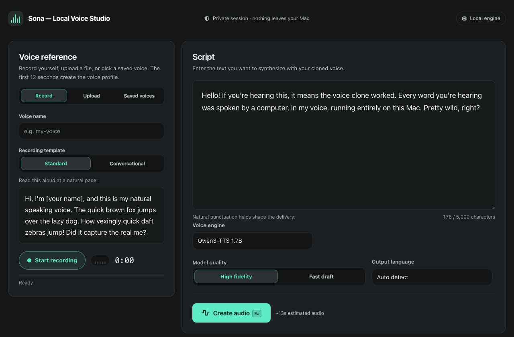

# Local voice cloning

This app clones a voice on your Apple Silicon Mac with Apple MLX. Audio never leaves your computer. You provide a short audio sample and text, and the app generates speech as a WAV or MP3 file.



## Quick start

You need an Apple Silicon Mac, Python 3.10 or newer, and about 8 GB of free disk space. The app downloads models automatically on the first run. Install the dependencies and start the web app:

```bash
uv sync
uv run shiny run app.py
```

Open the URL from your terminal, for example `http://127.0.0.1:<port>`, and follow these steps:

1. Record or upload a 5 to 12 second clip in a quiet room, or select a saved voice.
2. Fix any mistakes in the automatic transcript.
3. Enter your script with commas and periods to control pacing, and click Create audio.

For 600+ languages with OmniVoice, run `uv sync --extra omnivoice` and `uv run --extra omnivoice shiny run app.py`. For the CLI, REST API, and agent documentation, run `uv run python -m src.cli --api-docs`.
